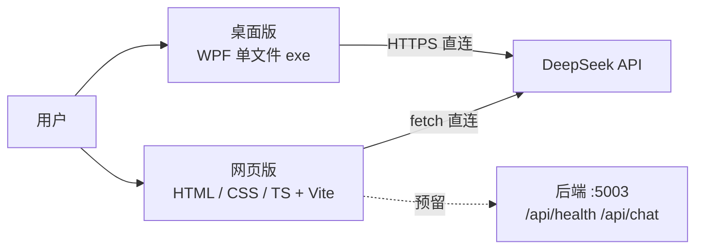

# 小沃 · My First DesktopPet

一只会说话、记得住你、能装在 Windows 上陪着的桌宠。同一个仓库里三份实现：网页版、WPF 桌面版、ASP.NET Core 后端。

> 这是我在大一做的第一个前后端分离项目，用来练习「一个人把东西做完并交出去」：从原生 HTML/CSS/TS 写起，到接大模型、做本地记忆、打包装机、发布下载。

<p>
  
</p>

---

## 下载桌面版（Windows x64）

### 要下哪个文件

到 **[Releases](https://github.com/pero23366/My_First_DesktopPet/releases/latest)** 页面，在 **Assets** 里下这个：

| 文件 | 说明 |
|---|---|
| `xiaowo-desktop-v1.0.0-win-x64.zip` | ✅ **要下的就是它**，约 59MB |
| `xiaowo-desktop-v1.0.0-win-x64.zip.sha256` | 校验值，想验证文件完整性才需要 |
| `Source code (zip)` / `(tar.gz)` | ❌ 这是源码，不是程序，别点 |

### 怎么用

1. 下载 zip。
2. 解压到任意目录（**不用安装**，不写注册表，不依赖 .NET —— 解压即用）。
3. 双击里面的 `AI桌宠_V1.0.0.exe`。
4. 首次打开会弹「Windows 已保护你的电脑」——这是没有买代码签名证书的正常提示：
   点 **更多信息** → **仍要运行**。
5. 点界面上的 **⚙ 设置 → DeepSeek API**，填自己的 API Key 后保存。
   没有 Key 的话，小沃只会重复规则表的固定回复。
6. 桌面版拖到屏幕任意位置；`Esc` 退出。

### 关于 API Key（重要）

- Key **只保存在你自己电脑的 `pet_settings.json`** 里，程序**直连 DeepSeek 官方接口**，不经过我的任何服务器，我拿不到你的 Key，也看不到你的对话。
- 因此**用量费用由你自己承担**（DeepSeek 按 token 计费，日常聊天很便宜）。
- 对话记录与记忆也都只存在本机同目录的 `conversation.json`，删掉即清空。

### 想校验文件没被改过

```powershell
certutil -hashfile xiaowo-desktop-v1.0.0-win-x64.zip SHA256
```

输出应当等于：

```
701154820d2ba1cdfa3511cc012b71153d58195d9b578a3021e2df3be3ff00a8
```

### GitHub 下不动怎么办

国内直连 `objects.githubusercontent.com` 经常很慢或断。按顺序试：

1. 加速线路：`https://ghfast.top/` + 完整下载链接
2. 夸克网盘备用：**（待填分享链接 + 提取码）**

> 如果点开 Releases 是 404，说明仓库还没设为公开 —— 此时只有协作者能下。

---

## 三个入口

| 版本 | 在哪 | 怎么跑 |
|---|---|---|
| 网页版（原生 TS） | 仓库根 | `npm install` → `npm run dev` → http://localhost:5173/ |
| 网页版（Vue 改版） | `pet-vue.html` + `Vue/` | 同上，访问 http://localhost:5173/pet-vue.html |
| 桌面版（WPF） | `desktop/` | 见 [desktop/README.md](desktop/README.md) |
| 后端（ASP.NET Core） | `VS/` | 见 [后端 README](VS/Full-stack%20project%20with%20frontend-backend%20separation--My%20First%20DesktopPet/README.md) |



## 目录结构

```
.
├─ index.html / CSS / TS / image   # 网页版：原生实现，零框架
├─ pet-vue.html / Vue              # 网页版：Vue 改版（逐步迁移，原版不动）
├─ desktop/                        # 桌面版：WPF，无边框 + 透明 + 置顶
├─ VS/…/                           # 后端：ASP.NET Core，端口 5003
├─ tools/publish-desktop.ps1       # 桌面版打包发布脚本
├─ docs/                           # 设计决策 / 踩坑记录 / 逐行解释（11 篇）
├─ 启动.bat                        # 网页版一键启动（装依赖 + 起 dev server）
└─ vite.config.ts                  # Vite 只当 dev server
```

## 技术栈与几个刻意的选择

| 选择 | 为什么 |
|---|---|
| 前端不用框架（原生 TS 起步） | 先把 DOM、事件、模块化这层地基踩实；Vue 版是第二阶段迁移，原版保留作对照 |
| TS `strict` 全开，`npm run build` 先跑 `tsc --noEmit` | 类型错误必须在构建阶段炸，而不是上线后 |
| Vite 只当 dev server | 产物 `dist/assets/index.js` 里 0 处 vite 运行时，没有框架锁定，将来换任何构建工具都不影响 |
| 桌面版自包含单文件（137MB → zip 59MB） | 框架依赖版只有 4MB，但要求用户先装 .NET 10 Desktop Runtime，普通人会在这一步放弃 |
| API Key 由用户自带、浏览器/客户端直连 | 不自建付费中转；代价是"用户要自己申请 Key"，收益是零成本且作者不经手隐私 |

## 文档

设计与决策都在 [`docs/`](docs/)：为什么这么分层、一条消息的完整旅程、API Key 与隐私的六轮抉择、桌面版全屏卡死的成因、每一版的迭代台账。

## 声明

- 小沃的形象来自 B 站 UP 主 **Warma** 的同人创作氛围，**本项目是非商业的个人学习作品**；不做声线克隆、不冒充本人、不使用原作者名义。
- 代码以 MIT 发布；形象素材版权归原作者，**禁止商用**。
